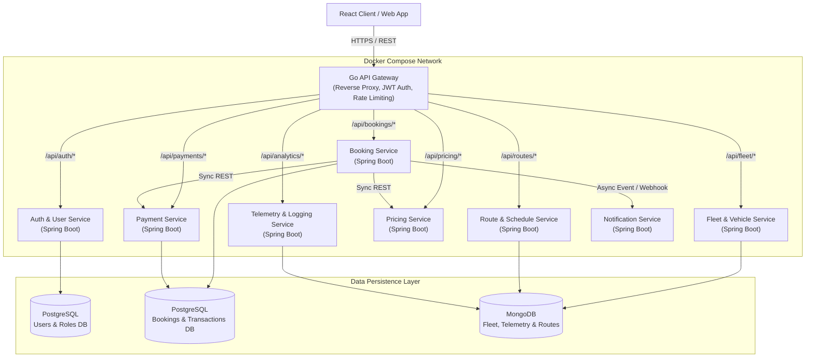
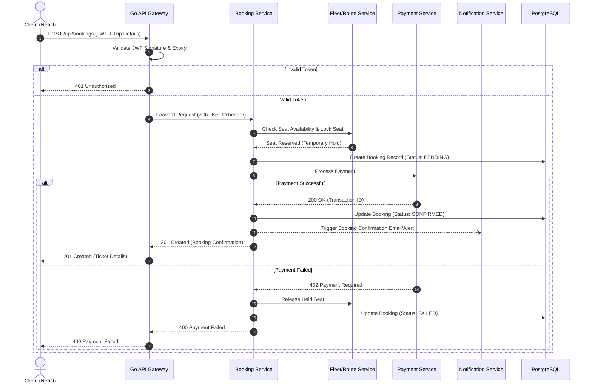

# Distributed Transport Booking Platform


A microservices-based transport booking and fleet management system built with **Java (Spring Boot)**, a custom **Go API Gateway**, **PostgreSQL**, and **MongoDB**. Designed to handle user authentication, route search, seat booking, payment processing, and live fleet tracking through isolated, containerized services.

---

## System Architecture

The backend is split into **8 independent services** behind a single Go API Gateway. Rather than sharing one massive database, each core domain manages its own data store to prevent tight coupling and single points of failure.



---

## Booking & Payment Flow (Sequence Diagram)

When a user books a trip, the **Go API Gateway** validates their JWT token first before forwarding the request to the **Booking Service**, which coordinates seat availability, fare calculation, payment, and user notifications.



---

## Core Services Overview

| Service | Tech Stack | Responsibility |
| :--- | :--- | :--- |
| **1. API Gateway** | Go (Golang) | Single entry point, reverse-proxy routing, round-robin load balancing, and JWT token verification. |
| **2. Auth & User Service** | Java, Spring Boot, PostgreSQL | User registration, login, password hashing (BCrypt), JWT issuance, and Role-Based Access Control (RBAC). |
| **3. Booking Service** | Java, Spring Boot, PostgreSQL | Manages trip reservations, seat locking, ticket lifecycle (`PENDING`, `CONFIRMED`, `CANCELLED`). |
| **4. Payment Service** | Java, Spring Boot, PostgreSQL | Handles fare checkout validation, transaction records, and refund state management. |
| **5. Fleet Management Service** | Java, Spring Boot, MongoDB | Tracks active vehicles, capacities, maintenance states, and driver assignments. |
| **6. Route & Schedule Service** | Java, Spring Boot, MongoDB | Stores stops, timetables, and calculates route connections across the transport network. |
| **7. Pricing Engine** | Java, Spring Boot | Computes dynamic ticket fares based on distance, vehicle class, and current demand. |
| **8. Notification Service** | Java, Spring Boot | Dispatches booking confirmations, cancellations, and schedule delay alerts to users. |

---

## Key Engineering Highlights

* **Custom Go API Gateway:** Instead of exposing all 8 Spring Boot services directly to the client, the Go gateway handles incoming HTTP traffic concurrently using goroutines, strips unauthorized requests at the edge, and routes valid traffic to internal Docker container hostnames.
* **Polyglot Persistence (PostgreSQL + MongoDB):**
  * **PostgreSQL** is used for **Users, Bookings, and Payments** where ACID transactions and relational integrity are critical (preventing double-booked seats).
  * **MongoDB** is used for **Fleet Telemetry, Routes, and Schedules** where flexible JSON schemas and fast document reads fit nested route/stop structures.
* **Containerized Local Environment:** The entire cluster including the Go gateway, Spring Boot services, PostgreSQL, and MongoDB instances spins up with a single `docker-compose up` command with configured health checks and restart policies.

---

## Getting Started

### Prerequisites
* **Docker** & **Docker Compose** installed on your machine
* *(Optional for local non-Docker builds)*: **Java 17+**, **Maven**, **Go 1.21+**, **Node.js 18+**

### Running the Full System via Docker Compose

1. **Clone the repository:**
   ```bash
   git clone https://github.com/gauravnaudiyal/distributed-transport-platform.git
   cd distributed-transport-platform
   ```

2. **Build and start all containers:**
   ```bash
   docker-compose up --build -d
   ```

3. **Verify running services:**
   ```bash
   docker-compose ps
   ```

4. **Stop and clean up containers:**
   ```bash
   docker-compose down
   ```

---

## Project Structure

```text
distributed-transport-platform/
├── api-gateway/               # Go reverse proxy, JWT validation & routing
├── auth-service/              # Spring Boot - User management & JWT generation
├── booking-service/           # Spring Boot - Core reservation state machine
├── payment-service/           # Spring Boot - Transaction processing
├── fleet-service/             # Spring Boot - Vehicle & driver inventory
├── route-service/             # Spring Boot - Timetables & route lookups
├── pricing-service/           # Spring Boot - Fare calculation rules
├── notification-service/      # Spring Boot - User alerts & confirmations
├── frontend/                  # React client dashboard
└── docker-compose.yml         # Multi-container orchestration config
```

---

## Author

**Gaurav Naudiyal**  
MSc in Computer Science, Trinity College Dublin  
[LinkedIn](https://www.linkedin.com/in/gaurav-naudiyal-277965388/) | [GitHub](https://github.com/gauravnaudiyal) | [Portfolio](https://gauravnaudiyal.github.io/)
