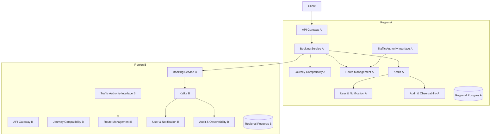
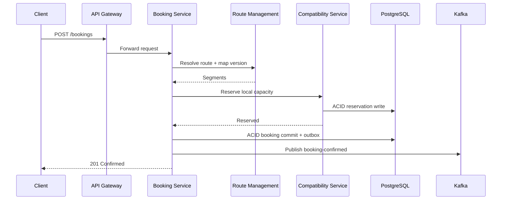
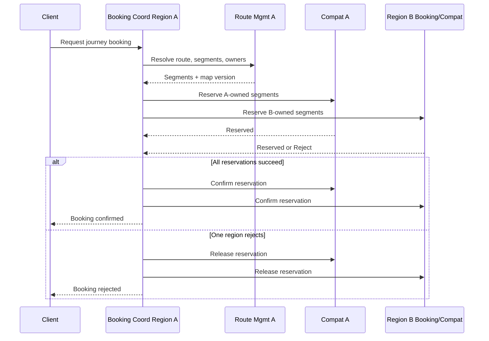

# Technical Architecture — Global Traffic Booking Service (GTBS)

## 1. Executive Summary

The Global Traffic Booking Service (GTBS) is a **federated distributed system** for pre-booking road journeys while ensuring that regulated route capacity constraints are never violated. Every person who drives on the road has to book their journey ahead of time. 

Unlike a centralized design, GTBS is **geographically partitioned by authoritative road-segment ownership**. Each region operates its own control plane and is the sole authority for admission decisions on the route segments it owns. This allows the platform to scale globally while preserving strong correctness where it matters.

The architecture follows a **microservices model with strict service data ownership**:

- Each service owns its own database and cache.
- Each geographic region operates an independent service deployment.
- Intra-region correctness uses **ACID transactions**.
- Cross-region bookings use a **reservation saga** over synchronous service calls.
- Kafka is used only for **non-correctness-critical asynchronous workflows**.
- Capacity is enforced strongly at the level of the **authoritative regional segment partition**.
- Global reporting and replicated views are eventually consistent.

This design gives high concurrency, regional fault isolation, and a clear consistency model for both domestic and international journeys.

**How to read this document.** Unless a subsection is explicitly labelled **as-built**, descriptions are **target architecture**—what the system is intended to become when fully federated and operationally hardened. For an itemised view of what the current codebase and local/typical deployments actually demonstrate, see `docs/implementation-checklist-response.md`.

------

## 1.1 Reference implementation status (as-built snapshot)

The following reflects the GTBS workspace as commonly run for development and demos (e.g. Docker Compose or a single-region AKS footprint), and is intentionally narrower than the full federated target above.

| Area | As-built (typical) | Target / not yet end-to-end |
|------|-------------------|-----------------------------|
| **Topology** | One logical region; all services reachable on one cluster or single-machine compose stack | Multiple independent regional control planes, geo DNS (e.g. Traffic Manager) routing clients to regional ingress |
| **Booking path** | Transactional booking lifecycle, idempotency (Redis), **pre-journey** compatibility check (HTTP), **live** route decomposition (HTTP to route-management), outbox + Kafka lifecycle events | Per-segment **HOLD/CONFIRM/RELEASE** fully enforced through journey-compatibility (or equivalent) for every segment; cross-region saga invoking peer regional services |
| **Capacity enforcement** | Strong **route-level** pre-check in journey-compatibility; Redis acceleration with DB reconciliation and fallback when cache is unavailable | Every governed segment’s admission solely via owning region’s compatibility/reservation API; no stubbed segment protocol |
| **Datastores** | Per-service PostgreSQL schemas/databases where configured; Redis; Kafka (or compatible broker) for async paths | Multi-AZ Postgres, replicated Kafka, HA Redis as in production baselines |
| **Authority / operator UI** | `admin-authority-service` and `traffic-authority-frontend` exist; authority workflows and UI-to-backend wiring vary by deployment | Full closure/restriction flows exclusively via authority interface into route-management (no direct booking-table mutation) |
| **Observability** | Observability service: Kafka consumption, audit persistence, read APIs; gateway health checks | Full OpenTelemetry + Prometheus + Grafana as primary operator experience |
| **Replication & DR** | Dependent on cloud/Helm choices when deployed; not uniformly scripted in app repos | Synchronous standby per region, cross-region async replication for DR/read models |

**Central invariant (unchanged):** no segment should be **confirmed** beyond capacity in its owning region. The **as-built** gap is mainly **integration depth**: segment-level reservation calls must be fully wired so that invariant is enforced mechanically for every segment, not only at the pre-check stage.

------

## 2. System Requirements

### Functional

Driver can:

- Request a journey booking with origin, destination, and time window.
- Receive a booking decision: confirmed or rejected.
- View booking status.
- Cancel a confirmed booking before the journey start time.
- Retry a booking request safely without creating duplicates.

Enforcement agent can:

- Verify whether a driver holds a valid confirmed booking.
- Inspect booking proof for a regulated journey.

Traffic authority can:

- Apply temporary road closures and restrictions.
- Change capacity limits for segments in its jurisdiction.
- View forecast demand on controlled roads.
- Verify bookings and audit records for enforcement purposes.

System can:

- Evaluate whether a journey is acceptable based on segment capacity constraints.
- Confirm a booking only if all affected route segments have available capacity.
- Reject a booking if any required segment would exceed its allowed limit.
- Provide verifiable proof of booking.
- Preserve durability of confirmed bookings.
- Coordinate multi-region journeys safely.
- Maintain auditable history of capacity rules, closures, and booking decisions.
- Keep bookings accessible across regions.

### Non-Functional

These are **design targets**. Measured p99 latency, availability, and load-test evidence depend on environment and are not centrally validated in the reference implementation repos—report measurements when you have them.

- Booking latency (single-region p99): less than 800 ms
- Booking latency (multi-region p99): bounded, target less than 1.5 s
- Status read latency: less than 200 ms
- Availability: 99.9% per region
- Strong consistency for authoritative segment admission
- Eventual consistency for global replicas, reporting, and analytics
- Tolerate node, instance, and availability-zone failures
- Continue local operation during cross-region partitions where possible

------

## 3. Architectural Style

GTBS is a **federated regional platform**.

Each region contains:

1. API Gateway
2. Booking Service
3. Journey Compatibility Service
4. Route Management Service
5. Traffic Authority Interface Service
6. User & Notification Service
7. Audit & Observability Service

**As-built.** Local and small-team deployments often run **one** copy of each service and **one** set of data services (single logical region). The list below describes how a **fully federated** production footprint partitions resources.

Each region has its own:

- PostgreSQL databases
- Redis caches
- Kafka infrastructure or region-scoped event topics
- Kubernetes deployment
- monitoring and logging stack

### Key Architectural Principle

The system is partitioned by **road-segment ownership**, not merely by user or booking origin.

That means:

- Every road segment belongs to exactly one authoritative region.
- Only that region may approve or reject capacity usage for that segment.
- A journey that spans multiple regions must be coordinated across the authoritative regions involved.

------

## 4. High-Level Federated Architecture

This makes explicit that the system is not a single global centralized deployment, but a federation of cooperating regional systems.

------

## 5. Core Services

## 5.1 API Gateway

The API Gateway is the regional ingress point for clients and operators.

Responsibilities:

- authentication and JWT validation
- request routing
- rate limiting
- optional request tracing (correlation IDs / OpenTelemetry—when enabled in deployment)
- reverse proxy to upstream service base URLs configured **per deployment** (not dynamic multi-region selection inside the gateway process)
- fail-fast behavior when downstream regional services are unavailable (e.g. per-upstream circuit breaking)

Properties:

- stateless
- horizontally scalable
- deployed per region
- in production, **client-facing** regional affinity is normally achieved **outside** the gateway (DNS geo-routing, Traffic Manager, Front Door), so each gateway instance still has static upstream URLs for its region

------

## 5.2 Booking Service

The Booking Service is the transactional core of the system.

Responsibilities:

- create bookings
- cancel bookings
- enforce idempotency
- coordinate multi-region booking workflows (**target**; requires peer regional booking/compatibility endpoints in deployment)
- manage booking lifecycle states
- publish booking lifecycle events through the outbox pattern

**As-built note.** The orchestrator implements a **two-phase segment protocol** (reserve / confirm / release) in the lifecycle, but **per-segment HTTP calls** to journey-compatibility may still be **stubbed** in some builds: compatibility is reliably exercised for the **initial** journey check, while each segment transition should be wired to the real reservation API to match this document’s federation story.

### Booking States

- `PENDING`
- `RESERVED`
- `CONFIRMED`
- `REJECTED`
- `CANCELLED`
- `FAILED`

### Local Responsibilities

For a single-region journey, Booking Service:

- requests route decomposition from route-management
- requests a **pre-journey** capacity / compatibility check from journey-compatibility (synchronous HTTP)
- (**target**) requests segment-level reservations so capacity is bound to each governed segment; (**as-built**) segment holds may be synthesized until clients are fully integrated
- commits booking (and segment rows where used) in a local ACID transaction
- records outbox event
- returns confirmation to client

### Multi-Region Responsibilities

For a multi-region journey, the initiating region acts as the **booking coordinator**:

- decomposes the route into governed segments
- determines authoritative owner for each segment
- issues reservation requests to affected regions
- waits for all reservation responses
- confirms or compensates accordingly

This service is therefore both a local transaction manager and a cross-region saga coordinator.

------

## 5.3 Journey Compatibility Service

The Journey Compatibility Service is responsible for capacity admission on route segments.

Responsibilities:

- evaluate segment capacity availability
- create provisional reservations for owned segments
- confirm or release reservations
- expose reservation APIs to peer regions
- maintain a fast, cached view of short-term capacity pressure

### Important Design Clarification

Redis counters are used as an **acceleration layer**, not as the final source of truth.

Authoritative correctness comes from **transactional reservation records in PostgreSQL**.

Therefore:

- Redis may be used for fast preliminary checks
- final reservation is persisted in the regional database inside a transaction
- counters can be rebuilt from authoritative reservation records
- if Redis fails, correctness is preserved

This avoids treating cache state as the basis of booking correctness.

------

## 5.4 Route Management Service

The Route Management Service owns the canonical representation of the road network.

Responsibilities:

- maintain the road network as a directed graph
- define bookable route segments
- assign every segment to an authoritative region
- store static capacity rules
- apply temporary restrictions and closures
- version all network and policy changes
- support route decomposition for booking evaluation

### Managed Data

- segment IDs
- topology and adjacency
- ownership by jurisdiction/region
- baseline capacities
- time-window policies
- temporary closures
- event-specific restrictions
- map version history

### Versioning

Every booking references the **map version** used during admission.

This ensures:

- auditability
- reproducibility of decisions
- safe re-evaluation after policy changes
- historical consistency even if the road graph changes later

This addresses the question of how the road map is managed: it is not an informal data set, but a versioned, authoritative domain model.

------

## 5.5 Traffic Authority Interface Service

This component corresponds to **admin-authority-service** (and operator-facing UI) in the implementation tree.

**As-built.** Service maturity varies by workspace snapshot: REST integration with route-management and full closure workflows should be verified per deployment. The **design** below remains the intended separation of concerns.

Responsibilities:

- authenticate and authorize road/traffic authorities
- accept road closures, restrictions, and capacity overrides
- expose booking verification endpoints
- provide forecast and utilization information for relevant jurisdictions
- expose audit records and policy history for regulated segments

Example interfaces:

- `POST /authority/closures`
- `POST /authority/restrictions`
- `POST /authority/capacity-overrides`
- `GET /authority/bookings/{bookingId}/verify`
- `GET /authority/segments/{segmentId}/forecast`
- `GET /authority/audit/{segmentId}`

### Design Constraint

Traffic authorities do not write directly into booking tables.

Instead:

- authority instructions are validated
- changes are applied through Route Management and Traffic Policy data
- versioned updates are then propagated to dependent services

This keeps operational control separate from booking state mutation.

------

## 5.6 User & Notification Service

Responsibilities:

- manage user profiles and preferences
- consume booking lifecycle events
- send email, SMS, or push notifications (channel integrations may be **mocked** / log-only in development)
- handle retries and dead-letter processing

This service is intentionally **not** on the synchronous correctness path.

That prevents notification latency or third-party provider issues from affecting booking admission.

------

## 5.7 Audit & Observability Service

Responsibilities:

- consume booking and policy events
- maintain append-only immutable audit logs
- support post-incident reconstruction
- provide metrics and traces (**recommended** in production deployments)
- expose independent verification path for enforcement and compliance

**As-built.** The observability microservice focuses on **Kafka-driven audit ingest** and **query APIs** over persisted audit records. Prometheus/Grafana/OpenTelemetry may be deployed alongside it but are not defined as a single mandatory bundle in application source.

**Target tooling** in mature operations:

- OpenTelemetry for tracing
- Prometheus for metrics
- Grafana for dashboards
- immutable audit storage for compliance review

------

## 6. Geographic Partitioning and Data Distribution

This is a key part of the revised architecture.

### Partitioning Model

GTBS is partitioned by **authoritative segment ownership**.

Each segment is assigned to one region based on operational control. Examples:

- country-based ownership
- state/province-based ownership
- metropolitan traffic zone ownership

### Why this partitioning works

It aligns:

- data ownership
- operational authority
- capacity enforcement
- failure boundaries
- legal/jurisdictional responsibility

### Data Placement

Each region stores:

- authoritative booking records for journeys initiated there
- authoritative reservation records for segments it owns
- local copies of route graph metadata needed for routing
- (**target**) replicated global booking index for read/search purposes—the reference codebases may rely on **direct service queries** until such an index is introduced

This means the system is globally accessible without requiring a single central write path (**when fully deployed**).

------

## 7. Consistency Model

The previous draft was too vague here. This version makes the model explicit.

### 7.1 Local Consistency

Within a region, strong consistency is enforced using PostgreSQL ACID transactions.

A local transaction can atomically:

- insert booking state
- insert or update segment reservation rows (schema and usage align with the segment protocol in booking)
- persist idempotency key usage
- write an outbox event

This provides strong correctness **within the booking service’s transactional boundary** in the as-built system. End-to-end segment capacity correctness additionally requires **non-stubbed** compatibility/reservation integration as described in §1.1.

### 7.2 Cross-Region Consistency

GTBS does **not** use a global distributed transaction across regions.

Instead, cross-region correctness uses a **reservation saga**:

1. create provisional reservations in all authoritative regions
2. confirm only if all succeed
3. release reservations if any fail

This is more reliable and more realistic than two-phase commit across global regions.

### 7.3 Eventual Consistency

Eventual consistency is acceptable only for:

- reporting
- global search indexes
- analytics
- notifications
- audit fan-out
- replicated read models

It is **not** acceptable for segment capacity enforcement.

### Consistency Invariant

The critical invariant is:

**No road segment may be confirmed beyond its capacity in the authoritative owning region.**

That is the central correctness property of the system.

------

## 8. Booking Protocols

## 8.1 Single-Region Booking

For journeys entirely inside one region:

**Idealised target flow.** In the **as-built** system, the decomposition call is live (route-management), the initial compatibility check is live (journey-compatibility), but the **“Reserve local capacity”** step per segment may still be shortcut inside booking until segment-level HTTP integration is complete. Kafka publication follows successful confirmation via the outbox pattern where configured.

Correctness is entirely local and strongly consistent **once** every segment reservation is enforced by the owning compatibility service rather than stubbed.

------

## 8.2 Multi-Region Booking

For journeys spanning multiple regions:

### Why this works

- each region makes decisions only for its own segments
- each local reservation is durable
- final confirmation happens only after all required holds succeed
- if one region fails, compensation prevents stranded holds

This directly addresses consistency for multi-national journeys.

**As-built.** Multi-region coordination through peer booking/compatibility instances is **design intent** for production federation; demos usually run **one** regional stack. Geographically labelled segments can still be returned from route-management to illustrate ownership without requiring two live clusters.

------

## 9. Why Kafka Is Used — and Why It Is Not Used for Booking Correctness

The previous version under-justified asynchronous event streams.

### Kafka is used for:

- notifications
- audit ingestion
- analytics
- cache invalidation
- downstream read-model updates
- operational monitoring

### Kafka is not used for:

- deciding whether a booking is accepted
- coordinating cross-region reservation
- enforcing segment capacity in real time

### Justification

Correctness-critical workflows require:

- bounded synchronous outcome
- immediate success/failure visibility
- controlled ordering
- clear compensation behavior

Therefore cross-region reservation uses synchronous service-to-service RPC.

Asynchronous events remain valuable because they:

- decouple secondary consumers
- reduce latency on the booking path
- isolate failures in non-critical services
- support replay and audit

So the architecture uses events where eventual consistency is acceptable, but avoids them on the correctness path.

------

## 10. Transactions, Replication, and Reliability

## 10.1 Transactions

Within a region, PostgreSQL transactions are used to atomically persist:

- booking row updates
- reservation records
- cancellation changes
- idempotency records
- outbox entries

Isolation level:

- `READ COMMITTED` may be acceptable for general booking flow if reservation rows are explicitly locked
- for hotspot segments, use row-level locking or a stricter pattern around segment reservation records

The key point is not merely “we use transactions”, but **what is transacted and why**.

------

## 10.2 Replication

**Target production baseline** (infrastructure-level; not automatically provisioned by every app repo):

### Within a region

- PostgreSQL primary with synchronous standby replica
- deployed across multiple availability zones
- failover through orchestrated promotion
- protects against single-node and single-AZ failures

### Across regions

- asynchronous replication
- used for disaster recovery, read distribution, global lookup, and analytics
- not relied on for correctness-critical admission decisions

Replication improves durability and availability, but it is not the mechanism for cross-region coordination.

------

## 10.3 Fault Tolerance

**Target:** each region is deployed across multiple availability zones.

Reliability measures (mix of **as-built** in code and **target** in platform):

- stateless application services with horizontal scaling (Kubernetes/Docker) (**supported**)
- health checks and automatic restarts (**platform**)
- Kafka replication factor at least 3 (**broker config / target**)
- Redis deployed with HA configuration (**target** for production; dev often single node)
- circuit breakers for regional dependencies (**API gateway** implements per-upstream breakers)
- reservation timeouts and compensation for partially completed cross-region bookings (**partially implemented** in booking saga; cross-region timeouts require multi-region deployment)

### Cross-Region Partition Behavior

If regions cannot communicate:

- new single-region journeys can continue within unaffected regions
- multi-region journeys involving disconnected regions may be temporarily rejected or remain pending until timeout policy is reached
- no unsafe assumption is made from stale replicated state

This preserves correctness under partition.

------

## 11. Idempotency and Safe Retries

Booking creation must support safe retry.

Design:

- client supplies idempotency key
- Booking Service stores key with request hash and booking outcome
- duplicate retry returns original result
- keys are enforced inside the same transaction as booking persistence

This prevents duplicate bookings under retries, gateway failures, or partial client disconnects.

------

## 12. Cancellation Model

Cancellation of a confirmed booking uses a similar consistency approach:

- determine affected authoritative regions
- release reserved capacity in those regions
- commit booking as cancelled
- publish cancellation event through outbox

For multi-region cancellation, the coordinator again uses a compensating workflow rather than a global distributed transaction.

------

## 13. Enforcement and Verification

Enforcement agents need a fast and trustworthy verification path.

Verification can be served through:

- authoritative regional booking store
- replicated verification index
- audit-backed proof validation

Booking proof should include:

- booking ID
- signed token or verifiable reference
- map version
- time window
- route/segment scope as needed for enforcement

This allows enforcement without coupling officers directly to internal booking storage structures.

------

## 14. Road Map Change Handling

This was missing before and should be explicit.

### When the road network changes

Examples:

- temporary road closure
- construction restriction
- emergency capacity reduction
- event-day override

The workflow is:

1. authority submits change through Traffic Authority Interface
2. Route Management validates and versions the update
3. dependent services receive route/policy update event
4. future bookings use the new map version
5. affected future confirmed bookings may be re-evaluated
6. users are notified if re-routing or cancellation is required

This makes road-map change management operationally credible.

------

## 15. Technology Stack

| Component               | Technology (as implemented / typical)     |
| ----------------------- | ----------------------------------------- |
| API Gateway             | **Go / Fiber**                            |
| Core Services           | Java / Spring Boot                        |
| Operator UI             | React / Vite (`traffic-authority-frontend`) |
| Database                | PostgreSQL                                |
| Cache                   | Redis                                     |
| Event Streaming         | Apache Kafka (Azure Event Hubs with Kafka API in cloud paths) |
| Container Orchestration | Kubernetes (AKS) or Docker Compose locally |
| Observability           | Observability microservice + Kafka audit; Prometheus/Grafana/OTel optional in deployment |
| Cloud Platform          | Azure (common for class deployments)      |

This stack supports the federated design; language choices follow **edge vs domain** separation (stateless Go gateway, Spring services).

------

## 16. Failure Demonstration Plan

**Aspirational curriculum coverage** (full list below) exceeds what every student environment can safely run; treat it as a **menu**. Minimum credible demos today usually include: **gateway 401/429**, **compatibility unavailable** (degraded or circuit-open behaviour), **booking idempotency replay**, **Kafka consumer catching up** after restart, and **route policy events** emitted when route-management changes topology.

Where infrastructure permits, additionally show:

- service instance crash with traffic rerouting (**K8s**)
- database primary failure with replica promotion (**managed Postgres**)
- Kafka broker failure without losing booking correctness for already-committed bookings
- Redis outage with degraded compatibility latency but DB fallback path
- cross-region partition (**two clusters** or simulated latency/blackhole) with single-region progress when possible
- concurrent booking attempts on the same synthetic route (idempotency + compatibility conflict semantics)
- failure during segment saga with compensation releasing earlier holds
- authority-issued closure updating map version and affecting **future** decompositions

Scale the script to **what your deployment can prove** and label the rest target behaviour.

------

## 17. Conclusion

The GTBS **target** architecture is a **federated regional distributed system**, not a centralized service with replicas.

Its main **design** properties are:

- geographic partitioning by authoritative road-segment ownership
- strong local correctness through ACID transactions in owning services
- safe multi-region booking through synchronous reservation sagas between regional coordinators
- asynchronous event streaming only for non-critical downstream workflows
- dedicated interfaces for traffic authorities
- versioned road-network management for auditability and operational control
- high availability through regional isolation, replication, and stateless scaling

The **reference implementation** already demonstrates the **single-region** critical path—including gateway ingress, booking orchestration, journey compatibility pre-check, live route decomposition, notifications, and audit consumption—but still requires **finishing integration** (per-segment compatibility, routine multi-region drills, and full authority workflows) before every bullet above is operationally true without caveats.